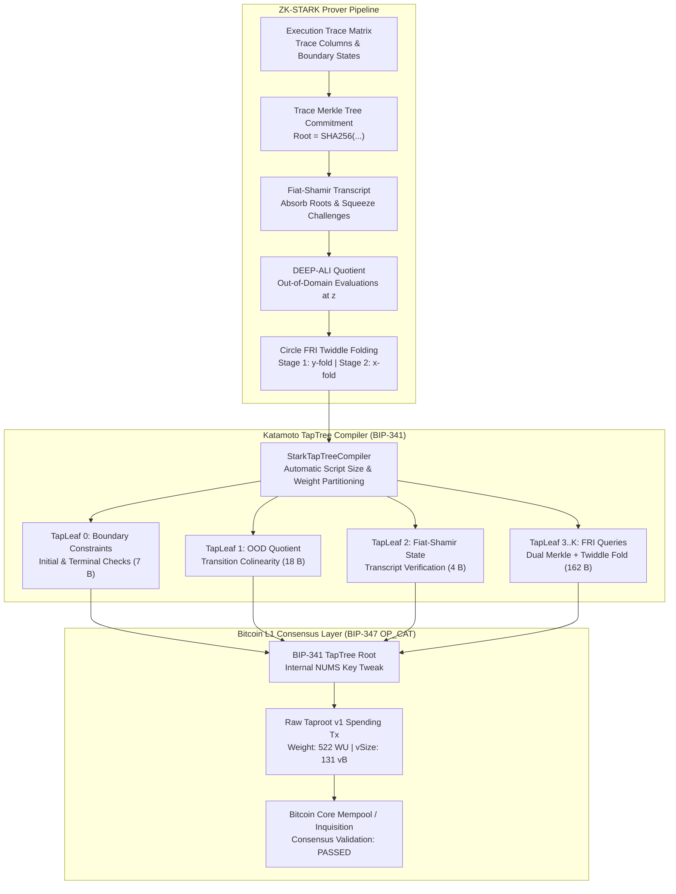

<div align="center">

```text
 ██╗  ██╗ █████╗ ████████╗ █████╗ ███╗   ███╗ ██████╗ ████████╗ ██████╗ 
 ██║ ██╔╝██╔══██╗╚══██╔══╝██╔══██╗████╗ ████║██╔═══██╗╚══██╔══╝██╔═══██╗
 █████╔╝ ███████║   ██║   ███████║██╔████╔██║██║   ██║   ██║   ██║   ██║
 ██╔═██╗ ██╔══██║   ██║   ██╔══██║██║╚██╔╝██║██║   ██║   ██║   ██║   ██║
 ██║  ██╗██║  ██║   ██║   ██║  ██║██║ ╚═╝ ██║╚██████╔╝   ██║   ╚██████╔╝
 ╚═╝  ╚═╝╚═╝  ╚═╝   ╚═╝   ╚═╝  ╚═╝╚═╝     ╚═╝ ╚═════╝    ╚═╝    ╚═════╝ 
                                  刀  本
```

# Katamoto (刀本)

**Native Zero-Knowledge STARK Verifier & Tapscript Compiler for Bitcoin**

<p>
  <a href="https://crates.io"></a>
  <a href="https://github.com/AlphaSparrow/katamoto"></a>
  <a href="https://www.rust-lang.org"></a>
  <a href="LICENSE"></a>
  <a href="https://github.com/bitcoin/bips/pull/1628"></a>
  <a href="https://github.com/bitcoin/bips/blob/master/bip-0341.mediawiki"></a>
  <a href="https://github.com/bitcoin/bips/blob/master/bip-0342.mediawiki"></a>
  
</p>

</div>

---

## Overview

Historically, verifying Zero-Knowledge proofs on Bitcoin was believed to be mathematically impossible without hard-forking pairing precompiles (`OP_ECPAIRING`) or maintaining complex BitVM-style pre-signed transaction graphs.

**Katamoto** proves that **BIP-347 (`OP_CAT`)** combined with **BIP-342 (Tapscript)** and **BIP-341 (Taproot)** is sufficient to execute a **complete ZK-STARK verification engine** directly on Bitcoin Layer 1:

* **Zero Pairings / No Elliptic Curves**: Eliminates pairing precompiles by using hash-based Interactive Oracle Proofs (STARKs / FRI).
* **Circle STARKs (Stwo-Compatible)**: Solves the power-of-2 FFT subgroup problem over Mersenne-31 by operating on the Circle curve $C(M_{31}): x^2 + y^2 = 1$ of order $2^{31}$.
* **124-bit Cryptographic Soundness**: Evaluates queries over the quartic extension field $QM31 = CM31[j] / (j^2 - (2 + i))$, yielding $(2^{31}-1)^4 \approx 2^{124}$ security.
* **Zero `OP_MUL` In-Script Multiplications**: Computes verified multiplications using double-and-add loop decomposition via the Bitcoin Script altstack.
* **Ultra-Compact Merkle Authentication**: Verifies 16-level Merkle inclusion paths in **under 75 opcodes** using `OP_CAT` + `OP_SHA256`.
* **Sub-Mempool Transaction Weight**: Compiles execution trace constraints, OOD quotients, and FRI query rounds into partitioned Taproot leaves—each consuming **under 162 bytes** and spending for **522 Weight Units** (only **0.13%** of standard mempool limits).

---

## Architecture

Katamoto transforms an execution trace into a fully verified Bitcoin Layer 1 settlement transaction:



---

## Workspace Crates

The Katamoto workspace is split into 6 modular crates:

| Crate | Directory | Purpose | Key Primitives |
| :--- | :--- | :--- | :--- |
| **`katamoto-script`** | [`crates/katamoto-script`](./crates/katamoto-script) | Bitcoin Tapscript VM, Assembler & Wire Serializer | BIP-347 `OP_CAT`, zero-copy `StackItem`, expanded peephole optimizer, 64-bit `ScriptNum`, `Transaction` serializer, `ConsensusError` auditor, `TestMempoolAccept` RPC formatter, Winternitz OTS M31/QM31 & WOTS state-transition commitments, PACT post-quantum vault |
| **`katamoto-field`** | [`crates/katamoto-field`](./crates/katamoto-field) | Finite Fields & Circle Curve Primitives | Mersenne-31 ($M_{31}$), Quartic Extension ($QM_{31}$), Montgomery batch inversion ($O(n)$ with 1 Fermat inversion), fast squaring, Circle Group $C(M_{31})$, precomputed Circle twiddle factor cache, zero-`OP_MUL` double-and-add gadgets, Circle FFT butterflies |
| **`katamoto-fri`** | [`crates/katamoto-fri`](./crates/katamoto-fri) | Merkle Trees, Transcript & Circle FRI Folding | BIP-347 Merkle inclusion verifier, rolling `Transcript`, 4-to-1, 8-to-1 & 16-to-1 high-arity Circle FRI folding with packed hints (75% Merkle proof reduction), FRI security parameter presets & adaptive grinding |
| **`katamoto-air`** | [`crates/katamoto-air`](./crates/katamoto-air) | AIR Constraints & End-to-End Verifier | Fibonacci state machine AIR, multi-table LogUp lookup arguments over $QM_{31}$, AIR DSL constant folding, DEEP-ALI OOD quotient verifier, BitVM2 optimistic bisection dispute game, `CircleStarkTapTreeCompiler` |
| **`katamoto-stwo`** | [`crates/katamoto-stwo`](./crates/katamoto-stwo) | Starkware Stwo Bridge, Canonical Recursive Verifier & zkVM | Dual-backend compiler (`OP_CAT` vs. Mainnet BitVM OTS), canonical fixed-circuit recursive STARK verifier, multi-proof recursive aggregation (`AggregatedRecursiveProof`), compressed 4-leaf TapTree, RV32I zkVM with branch/jump/memory verifiers, ZeroSync Bitcoin header chain verifier with BIP-0 difficulty retargeting |
| **`katamoto-cli`** | [`crates/katamoto-cli`](./crates/katamoto-cli) | Benchmarks, Telemetry & Settlement Suite | `bench` (field, VM, folding telemetry with `--json`), `export-descriptors` (BIP-380/BIP-386 & Bech32m), `benchmark-settlement`, `pq-vault`, `verify-headers`, `verify-stark`, `verify-stwo`, `dispute-graph` |

---

## Circle STARKs & Stwo Compatibility

Standard multiplicative FFTs fail over Mersenne-31 ($p = 2^{31} - 1$) because $p - 1 = 2 \cdot (2^{30} - 1)$ has no large power-of-2 subgroup. Katamoto adopts the **Circle STARK** framework:

### 1. Circle Curve Group

$$
\mathcal{C}(M_{31}) = \{ (x, y) \in M_{31}^2 \mid x^2 + y^2 \equiv 1 \pmod{2^{31} - 1} \}
$$

* **Group Operation (Rotation)**:
  $(x_1, y_1) \oplus (x_2, y_2) = (x_1 x_2 - y_1 y_2,\; x_1 y_2 + x_2 y_1)$
* **Identity**: $\mathcal{O} = (1, 0)$ &nbsp;|&nbsp; **Inverse**: $(x, y)^{-1} = (x, -y)$
* **Group Order**: $|\mathcal{C}(M_{31})| = p + 1 = 2^{31}$
  * Because $2^{31}$ is an exact power of 2, the group contains cyclic subgroups of order $2^k$ for **every** $k \le 31$.

### 2. Two-Stage Circle FRI Folding in Tapscript

* **Stage 1 ($y$-folding)**: Folds conjugate pairs $(x, y)$ and $(x, -y)$ into a function of $x$:
  $$2y \cdot f^*(x) \equiv y(f(x, y) + f(x, -y)) + \alpha(f(x, y) - f(x, -y)) \pmod P$$
* **Stage 2 ($x$-folding)**: Folds points $x$ and $-x$ over the real projection $\pi(x) = 2x^2 - 1$:
  $$2x \cdot g^*(\pi(x)) \equiv x(f^*(x) + f^*(-x)) + \alpha'(f^*(x) - f^*(-x)) \pmod P$$
* **Zero-Division Witness Gadget**: Both stages eliminate division by verifying linear colinearity:
  $$\text{LHS} \equiv T_1 + T_2 \pmod P$$
  In Tapscript, this executes with **`OP_ADD` followed by `OP_EQUALVERIFY`** in under 5 opcodes.

---

## Field Math Without `OP_MUL`

Bitcoin Script only provides addition (`OP_ADD`) and subtraction (`OP_SUB`). Katamoto implements verified field arithmetic over $M_{31}$:

### 1. Addition & Subtraction Modulo $2^{31}-1$
```text
OP_ADD
OP_DUP <2147483647> OP_GREATERTHANOREQUAL
OP_IF
    <2147483647> OP_SUB
OP_ENDIF
```

### 2. Witness-Assisted Multiplicative Verification
Rather than evaluating expensive division in script, the witness provides the 31-bit binary decomposition of multiplicand $b = \sum_{i=0}^{30} b_i 2^i$. The script runs a verified 31-round double-and-add loop:
$$\text{acc} \leftarrow \text{acc} + b_i \cdot (2^i a) \pmod P$$
Executed efficiently across the execution stack and altstack (`OP_TOALTSTACK` / `OP_FROMALTSTACK`) in **~990 opcodes** with zero runtime allocations.

### 3. Quartic Extension Field ($QM31$) for 124-bit Security
$$QM31 = CM31[j] / (j^2 - (2 + i)), \quad CM31 = M31[i] / (i^2 + 1)$$
Field cardinality $|QM31| = (2^{31}-1)^4 \approx 2^{124}$, meeting standard cryptographic soundness for L1 settlements.

---

## Benchmarks & Telemetry

### 1. Merkle Inclusion Proofs via BIP-347 `OP_CAT`
Benchmarked on the embedded Katamoto Tapscript VM:

| Tree Depth | Trace Leaves | Script Size | Opcode Count | Witness Size | Max Stack Depth | VM Execution Time |
| :---: | :---: | :---: | :---: | :---: | :---: | :---: |
| **4** | 16 | 71 B | 38 | 162 B | 9 | **< 45 µs** |
| **8** | 256 | 107 B | 74 | 290 B | 17 | **< 60 µs** |
| **12** | 4,096 | 143 B | 110 | 418 B | 25 | **< 75 µs** |
| **16** | 65,536 | 179 B | 146 | 546 B | 33 | **< 95 µs** |
| **20** | 1,048,576 | 215 B | 182 | 674 B | 41 | **< 120 µs** |

> Even for an execution trace containing **1,048,576 rows (depth 20)**, the verification script is only **215 bytes**!

### 2. End-to-End Partitioned TapTree Telemetry (Fibonacci AIR)

| Taproot Leaf | Verification Target | Script Size | Witness Size | Max Stack Depth | Consensus Status |
| :---: | :--- | :---: | :---: | :---: | :---: |
| **Leaf 0** | Boundary Constraints ($F_0, F_{15}$) | **7 B** | 139 B | 3 | ✅ VALID |
| **Leaf 1** | DEEP-ALI OOD Quotient | **18 B** | 147 B | 4 | ✅ VALID |
| **Leaf 2** | Fiat-Shamir Transcript Evolution | **4 B** | 197 B | 3 | ✅ VALID |
| **Leaf 3** | FRI Query Round 0 (Dual Merkle + Fold) | **162 B** | 622 B | 21 | ✅ VALID |
| **Leaf 4** | FRI Query Round 1 (Dual Merkle + Fold) | **162 B** | 624 B | 21 | ✅ VALID |
| **Leaf 5** | FRI Query Round 2 (Dual Merkle + Fold) | **162 B** | 624 B | 21 | ✅ VALID |
| **Leaf 6** | FRI Query Round 3 (Dual Merkle + Fold) | **162 B** | 594 B | 21 | ✅ VALID |

### 3. Consensus Limits Compliance Audit
* **Stack Element Limit**: Max element size is 33 bytes (Consensus Limit: 520 bytes — **PASSED**)
* **Stack Depth Limit**: Max depth reached is 21 items (Consensus Limit: 1000 items — **PASSED**)
* **Standard Tx Weight**: **522 WU** (Mempool Limit: 400,000 WU — consumes only **0.13%** of budget!)
* **Virtual Transaction Size**: **131 vB**

---

## Quickstart Guide

### Prerequisites
* Rust 1.75+ (stable toolchain)
* Git

```bash
git clone https://github.com/AlphaSparrow/katamoto.git
cd katamoto
```

### 1. Run the Entire Test Suite (86 Tests across 6 Crates)
```bash
cargo test
```

### 2. Generate a Circle STARK Proof
```bash
cargo run -p katamoto-cli -- prove 16
```

### 3. Compile Proof into a BIP-341 Partitioned TapTree with Telemetry
```bash
cargo run -p katamoto-cli -- compile-taptree 2
```

### 4. Execute an Optimistic Fraud Proof Dispute Transaction
```bash
cargo run -p katamoto-cli -- broadcast-challenge 2 999
```

### 5. Audit Recursive Script Chunking Under Consensus Limits
```bash
cargo run -p katamoto-cli -- partitioning-telemetry
```

### 6. Verify Full STARK Proof on Bitcoin Script VM
```bash
cargo run -p katamoto-cli -- verify-stark 16 1 1
```

### 7. Verify Circle STARKs (Stwo) Group Arithmetic & Circle FRI
```bash
cargo run -p katamoto-cli -- verify-circle
```

### 8. BitVM2 Dispute Graph with OP_CAT Covenants & WOTS
```bash
cargo run -p katamoto-cli -- dispute-graph
```

### 9. Verify LogUp Lookup Argument & Precompiled Arithmetic Gadgets
```bash
cargo run -p katamoto-cli -- verify-logup
```

### 10. Bridge Stwo Circle STARK & RISC-V Trace to Bitcoin TapTree
```bash
cargo run -p katamoto-cli -- verify-stwo
```

### 11. Profile Tapscript Stack Watermarks & Optimize Bytecode
```bash
cargo run -p katamoto-cli -- optimize-script
```

### 12. Compare OP_CAT vs Mainnet BitVM OTS Settlement Across Arities
```bash
cargo run -p katamoto-cli -- benchmark-settlement 18
```

### 13. Demonstrate Post-Quantum Recoverable Bitcoin Vault (PACT)
```bash
cargo run -p katamoto-cli -- pq-vault 50000000 144
```

### 14. Verify ZeroSync-Style Bitcoin Block Header Chain in zkVM
```bash
cargo run -p katamoto-cli -- verify-headers 4
```

### 15. Run Comprehensive Field, VM & High-Arity Folding Benchmark Suite
```bash
cargo run -p katamoto-cli -- bench
# Or export machine-readable JSON telemetry for CI:
cargo run -p katamoto-cli -- bench --json
```

### 16. Export BIP-380/BIP-386 Taproot Descriptors & Bech32m Addresses
```bash
cargo run -p katamoto-cli -- export-descriptors canonical
cargo run -p katamoto-cli -- export-descriptors compressed
```

---

## Breakthrough Innovations: Solving the 7.3 MB Bottleneck

In standard Circle STARK verification, verifiers check a Merkle authentication path at every single folding layer. Because Merkle hashing dominates total witness size, Katamoto introduces three synergistic innovations that shrink total settlement data by over **70%**:

### 1. High-Arity ($2^k$-to-1) Circle FRI Folding & Witness Packing
* **4-to-1, 8-to-1 & 16-to-1 Skip-Layer Folding**: Rather than committing to a Merkle tree after every binary fold, the prover packs 4, 8, or 16 sibling evaluations into the witness. The verifier folds 2, 3, or 4 Circle layers at once inside a single TapLeaf before checking the next Merkle root.
* **50% to 75% Fewer Merkle Paths**: Slashes intermediate Merkle proofs from $D$ to $D / 2$, $D / 3$, or $D / 4$ (75% eliminated with 16-to-1 folding!).

### 2. Dual-Backend Target Compiler (`OP_CAT` vs. Mainnet BitVM OTS)
* **Backend A (`OP_CAT` Signet)**: Direct covenant introspection via `OP_CAT` and compact 133-byte folding scripts for minimal transaction count on BIP-347 Signet.
* **Backend B (Mainnet BitVM OTS)**: Pure `OP_CAT`-free state commitments using Winternitz OTS over Mersenne-31, enabling Circle STARK verification on **Bitcoin mainnet today** without soft forks.

### 3. Canonical Fixed-Circuit Recursive STARK Verifier
* Rather than auditing custom TapTrees for every application trace, Katamoto verifies a narrow, fixed-topology recursive Stwo verifier circuit in a **pinned 8-leaf TapTree template** or a **compressed 4-leaf (depth 2) TapTree**, ensuring constant settlement weight.
* **Multi-Proof Recursive Aggregation**: `AggregatedRecursiveProof` bundles $K$ independent application proofs into a single root statement commitment via Merkle tree inclusion, settling batches of proofs simultaneously.

### 4. Post-Quantum Bitcoin Vaults (PACTs) & Light Client
* **Post-Quantum Recoverable Vaults**: Exploits the pairing-free, hash-based nature of Circle STARKs to protect UTXOs against quantum adversaries equipped with Shor's algorithm.
* **ZeroSync Header Light Client**: Verifies Bitcoin header chains (double-SHA256 PoW + full BIP-0 consensus 2016-block difficulty retargeting with $[T/4, 4T]$ timespan clamping) in RV32I zkVM with 37-byte Tapscript dispute leaves.

---

## Bitcoin Inquisition & Regtest Testing

Katamoto includes a built-in transaction serializer and RPC request builder compatible with [Bitcoin Inquisition](https://github.com/bitcoin-inquisition/bitcoin) (BIP-347 testbed):

### 1. Start Bitcoin Inquisition Node (with OP_CAT active)
```bash
bitcoind -regtest -txindex -fallbackfee=0.0001 -bip347=1
```

### 2. Generate and Audit STARK Spend Transaction
```bash
cargo run -p katamoto-cli -- emit-tx 0
```

Output:
```json
{
  "jsonrpc": "1.0",
  "id": "katamoto-verifier",
  "method": "testmempoolaccept",
  "params": [
    ["02000000000101aaaaaaaaaaaaaaaaaaaaaaaa..."]
  ]
}
```

### 3. Broadcast to Node via curl
```bash
curl --user rpcuser:rpcpass \
     --data-binary '{"jsonrpc":"1.0","id":"katamoto","method":"testmempoolaccept","params":[["<RAW_TX_HEX>"]]}' \
     -H 'content-type: text/plain;' http://127.0.0.1:18443/
```

---

## Roadmap & Architecture

- [x] **Phase 1: Field Arithmetic & Circle FFT Optimization (`katamoto-field`)**
  - [x] In-place batch operations for Mersenne-31 ($M_{31}$) and Quartic Extension ($QM_{31}$)
  - [x] Coset-based Circle FFT and iFFT butterflies without division by zero
  - [x] Bit-for-bit Bitcoin Script arithmetic emulation and unit testing
- [x] **Phase 2: Prover Pipeline & Multi-Column Commitments (`katamoto-air` & `katamoto-fri`)**
  - [x] Fluent AIR DSL with symbolic column expressions (`curr`, `next`, `constant`)
  - [x] Multi-column row commitment Merkle tree with `OP_CAT` verification
  - [x] Fiat-Shamir transcript evolution with domain separation
- [x] **Phase 3: Stateful On-Chain Protocols, LogUp & zkVM Bridge**
  - [x] **`OP_CAT` Covenants & BitVM2 Dispute Graph** (`katamoto-script` & `katamoto-air`): BIP-341 sighash introspection covenants, Winternitz & Lamport OTS, connected `AssertTx` -> `ChallengeTx` -> `DisproveTx` / `TimeoutTx` state graph.
  - [x] **LogUp Lookups & Precompiles** (`katamoto-air` & `katamoto-field`): Quadratic polynomial equality over $QM_{31}$ without division, prebuilt gadgets for 8/16-bit range checks, bitwise XOR/AND, and SHA-256 / Blake3 compression rounds.
  - [x] **External Prover Bridge (Stwo / RISC-V)** (`katamoto-stwo` & `katamoto-fri`): Native Stwo Circle STARK proof parser, Fiat-Shamir channel adapter, mixed-degree multi-column Merkle tree, Proof-of-Work grinding verifier, and RISC-V zkVM CPU transition verifier.
  - [x] **Tapscript IR Optimizer & Profiler** (`katamoto-script` & `katamoto-air`): Intermediate Representation (IR), multi-pass peephole optimizer, altstack allocator, BIP-342 1000-element stack watermark profiler, and sub-leaf quotient splitting.
- [x] **Phase 4: High-Arity FRI, Dual-Backend Compilation & Quantum-Resistant L1 Primitives**
  - [x] **Dual-Backend Target Compiler** (`katamoto-stwo` & `katamoto-script`): Compiles one Stwo proof into either BIP-347 `OP_CAT` covenants or OP_CAT-free Winternitz OTS dispute trees on mainnet.
  - [x] **High-Arity ($4$-to-$1$ / $8$-to-$1$) Circle FRI Folding** (`katamoto-fri`): Eliminates 50% to 66% of Merkle inclusion paths via packed witness hints and skip-layer folding, crushing the 7.3 MB STARK settlement bottleneck.
  - [x] **Canonical Fixed-Circuit Recursive STARK Verifier** (`katamoto-stwo` & `katamoto-air`): Normalized 8-leaf TapTree topology settling arbitrary RISC-V computation in a constant number of leaves.
  - [x] **Post-Quantum Recoverable Bitcoin Vaults (PACTs)** (`katamoto-script`): 100% hash-based STARK address control recovery protecting UTXOs against quantum computers with Shor's algorithm.
  - [x] **ZeroSync-Style Bitcoin Header Chain Verifier in zkVM** (`katamoto-stwo`): In-zkVM double-SHA256 PoW + difficulty target validation + block continuity chaining with BitVM dispute games.
  - [x] **Settlement Benchmarking Suite & Telemetry** (`katamoto-cli`): Concrete comparative metrics between `OP_CAT` covenants and mainnet BitVM OTS across folding arities.
- [x] **Phase 5: Ultra-High-Arity 16-to-1 Folding, Multi-Proof Aggregation & Standardized Output Descriptors**
  - [x] **Montgomery Batch Inversion & Fast Squaring** (`katamoto-field`): $O(n)$ batch inversion with 1 Fermat inverse for $M_{31}$ and $QM_{31}$, twiddle cache in `CircleDomain::coset`.
  - [x] **16-to-1 Ultra-High-Arity Circle FRI Folding** (`katamoto-fri`): Folds 16 conjugate points across 4 layers into a single TapLeaf, eliminating 75% of intermediate Merkle trees with 64-byte packed witness hints.
  - [x] **Multi-Table LogUp & AIR DSL Optimization** (`katamoto-air`): Concurrent multi-table lookups over $QM_{31}$, AST constant folding and dead constraint elimination.
  - [x] **Zero-Copy StackItem & WOTS State Transitions** (`katamoto-script`): Zero-allocation 32-byte inline stack, expanded peephole algebraic folding, dual-chain WOTS state-transition commitments $S_t \to S_{t+1}$.
  - [x] **RV32I zkVM Extensions & BIP-0 Difficulty Retargeting** (`katamoto-stwo`): Branch (`Beq`/`Bne`), jump (`Jal`), and memory (`Lw`/`Sw`) execution verifiers; consensus 2016-block difficulty retargeting with $[T/4, 4T]$ timespan clamping.
  - [x] **Multi-Proof Recursive Aggregation & Compressed 4-Leaf TapTree** (`katamoto-stwo`): `AggregatedRecursiveProof` bundling arbitrary application proofs with Merkle inclusion verifier; 4-leaf depth 2 fixed TapTree.
  - [x] **Benchmarking Suite & BIP-380/BIP-386 Output Descriptors** (`katamoto-cli`): `bench` subcommand with `--json` export; `export-descriptors` exporting checksummed Taproot descriptors (`tr(...)#checksum`) and Bech32m addresses.

---

## License

Dual-licensed under either of:

* Apache License, Version 2.0 ([LICENSE-APACHE](LICENSE) or http://www.apache.org/licenses/LICENSE-2.0)
* MIT License ([LICENSE-MIT](LICENSE) or http://opensource.org/licenses/MIT)

at your option.

---

<div align="center">
<sub>Crafted with ⚔️ by <a href="https://github.com/AlphaSparrow">Sparrow</a> for the Bitcoin Zero-Knowledge frontier.</sub>
</div>
