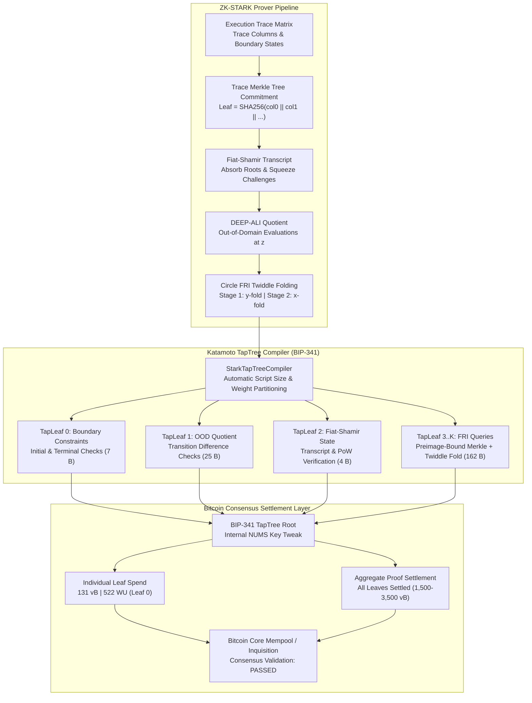

<div align="center">

```text
 ██╗  ██╗ █████╗ ████████╗ █████╗ ███╗   ███╗ ██████╗ ████████╗ ██████╗ 
 ██║ ██╔╝██╔══██╗╚══██╔══╝██╔══██╗████╗ ████║██╔═══██╗╚══██╔══╝██╔═══██╗
 █████╔╝ ███████║   ██║   ███████║██╔████╔██║██║   ██║   ██║   ██║   ██║
 ██╔═██╗ ██╔══██║   ██║   ██╔══██║██║╚██╔╝██║██║   ██║   ██║   ██║   ██║
 ██║  ██╗██║  ██║   ██║   ██║  ██║██║ ╚═╝ ██║╚██████╔╝   ██║   ╚██████╔╝
 ╚═╝  ╚═╝╚═╝  ╚═╝   ╚═╝   ╚═╝  ╚═╝╚═╝     ╚═╝ ╚═════╝    ╚═╝    ╚═════╝ 
                                  刀  本
```

# Katamoto (刀本)

**Native Zero-Knowledge STARK Verifier & Tapscript Compiler for Bitcoin**

<p>
  <a href="https://github.com/AlphaSparrow/katamoto"></a>
  <a href="https://www.rust-lang.org"></a>
  <a href="LICENSE"></a>
  <a href="https://github.com/bitcoin/bips/pull/1628"></a>
  <a href="https://github.com/bitcoin/bips/blob/master/bip-0341.mediawiki"></a>
  <a href="https://github.com/bitcoin/bips/blob/master/bip-0342.mediawiki"></a>
  
</p>

</div>

---

## Overview

Verifying Zero-Knowledge STARK proofs directly on Bitcoin Layer 1 has historically faced severe consensus hurdles: lack of native pairing precompiles, strict 201-opcode-per-leaf script limits under BIP-342, and the 4-byte signed operand limit on `ScriptNum` arithmetic.

**Katamoto** provides a mathematically rigorous, consensus-strict STARK verification engine and Tapscript compiler designed for **BIP-347 (`OP_CAT`)** and **BIP-341/342 (Taproot / Tapscript)**:

* **Zero Pairings / No Elliptic Curves**: 100% hash-based Interactive Oracle Proofs (STARKs / FRI).
* **Circle STARKs (Stwo-Compatible)**: Operates over Mersenne-31 on the Circle curve $\mathcal{C}(M_{31}): x^2 + y^2 = 1$ of order $2^{31}$, enabling large power-of-2 FFTs.
* **Strict BIP-342 4-byte ScriptNum**: Enforces consensus-strict 4-byte signed numeric limits ($[-2^{31}+1, 2^{31}-1]$) using an overflow-free subtraction trick ($a - (p - b)$) for all $M_{31}$ additions.
* **Cryptographic Preimage Binding**: Binds trace and Circle evaluation field elements ($f(P), f(P_{\text{conj}})$) directly to Merkle leaf preimages via `OP_CAT` + `OP_SHA256`.
* **Dual Execution Modes**:
  * **Signet OP_CAT Mode**: Direct covenant introspection and skip-layer folding scripts settling on BIP-347 testbeds.
  * **Mainnet BitVM2 Mode**: Optimistic fraud proofs using Winternitz One-Time Signatures (WOTS) over $M_{31}$ state commitments, enabling Circle STARK verification on Bitcoin mainnet today without soft forks.
* **Transparent Settlement Accounting**: Individual partitioned Taproot leaves spend in as few as **131 vB / 522 WU**, while complete multi-leaf STARK proofs settle in aggregate across transactions well within the 400,000 WU mempool budget.

---

## Architecture

Katamoto transforms an execution trace into a fully verified Bitcoin Layer 1 settlement structure:



---

## Workspace Crates

The Katamoto workspace is organized into 6 modular crates:

| Crate | Directory | Purpose | Key Primitives |
| :--- | :--- | :--- | :--- |
| **`katamoto-script`** | [`crates/katamoto-script`](./crates/katamoto-script) | Bitcoin Tapscript VM & Serializer | BIP-347 `OP_CAT`, strict 4-byte `ScriptNum` consensus limits, peephole optimizer, `Transaction` wire serializer, `ConsensusError` auditor, `TestMempoolAccept` RPC formatter, Winternitz OTS M31/QM31 state commitments, PACT post-quantum vault |
| **`katamoto-field`** | [`crates/katamoto-field`](./crates/katamoto-field) | Finite Fields & Circle Primitives | Mersenne-31 ($M_{31}$), Quartic Extension ($QM_{31}$), consensus-safe subtraction-trick addition ($a - (p-b)$), Montgomery batch inversion, fast squaring, Circle Group $\mathcal{C}(M_{31})$, verified double-and-add multiplicative gadgets, Circle FFT butterflies |
| **`katamoto-fri`** | [`crates/katamoto-fri`](./crates/katamoto-fri) | Merkle Trees & Circle FRI Folding | BIP-347 Merkle inclusion verifier, leaf preimage binding (`OP_CAT` + `OP_SHA256`), rolling `Transcript`, 4-to-1, 8-to-1 & 16-to-1 high-arity Circle FRI folding with packed hints, derived soundness bounds & PoW grinding |
| **`katamoto-air`** | [`crates/katamoto-air`](./crates/katamoto-air) | AIR Constraints & Dispute Games | Fibonacci state machine AIR, multi-table LogUp lookup arguments over $QM_{31}$, AIR DSL constant folding, DEEP-ALI OOD quotient verifier, BitVM2 optimistic bisection dispute game, `CircleStarkTapTreeCompiler` |
| **`katamoto-stwo`** | [`crates/katamoto-stwo`](./crates/katamoto-stwo) | Stwo Bridge & zkVM Verifier | Dual-backend compiler (`OP_CAT` vs. Mainnet BitVM OTS), canonical fixed-circuit recursive STARK verifier, multi-proof recursive aggregation (`AggregatedRecursiveProof`), RV32I zkVM execution verifier, ZeroSync header chain verifier with 2016-block difficulty retargeting |
| **`katamoto-cli`** | [`crates/katamoto-cli`](./crates/katamoto-cli) | Benchmarks & Settlement CLI | `bench` (field, VM, folding telemetry with `--json`), `export-descriptors` (BIP-380/BIP-386 & Bech32m), `benchmark-settlement`, `emit-tx`, `pq-vault`, `verify-headers`, `verify-stark`, `verify-stwo`, `dispute-graph` |

---

## Cryptographic Soundness & Math

### 1. Soundness Derivation in FRI
In FRI and Circle STARKs, field cardinality $|QM_{31}| \approx 2^{124}$ bounds the Fiat-Shamir sampling error, but query soundness is governed by the code rate and query count:

$$\epsilon_{\text{soundness}} \le \left(1 - \frac{\delta}{2}\right)^q + \frac{d}{|\mathbb{F}|} + 2^{-\text{pow\_bits}}$$

where $\rho = 2^{-\text{blowup}}$ is the rate, $\delta = 1 - \rho$ is the minimum distance, $q$ is the query count, and $\text{pow\_bits}$ is proof-of-work grinding difficulty:

| Configuration | Queries ($q$) | Blowup ($\rho^{-1}$) | PoW Grinding | Effective Soundness | Intended Use |
| :--- | :---: | :---: | :---: | :---: | :--- |
| **Test Profile** | 4 | 4 ($\rho = 1/4$) | 0 bits | $\approx 3\text{--}8$ bits | Local unit & VM regression testing |
| **Fast Signet** | 28 | 4 ($\rho = 1/4$) | 16 bits | $\approx 64$ bits | Interactive Signet devnets |
| **Standard L1** | 56 | 8 ($\rho = 1/8$) | 20 bits | $\approx 96$ bits | Secure Layer 1 settlement |
| **Production High-Sec** | 80 | 16 ($\rho = 1/16$) | 24 bits | $\approx 128$ bits | Production high-value rollups |

### 2. Consensus-Strict $M_{31}$ Addition (The Subtraction Trick)
BIP-342 enforces that arithmetic operands must be at most 4 bytes signed ($[-2^{31}+1, 2^{31}-1]$). When adding two elements in $M_{31}$ ($p = 2^{31} - 1$):
* Direct addition $a + b$ can reach $2p - 2 = 2^{32} - 4 > 2^{31} - 1$, which requires a 5th sign byte in Bitcoin's ScriptNum encoding and triggers `SCRIPT_ERR_UNKNOWN_ERROR` on standard Bitcoin Core nodes.
* Katamoto eliminates this overflow without limb splitting via the **subtraction trick**:
  $$b' = p - b \in [1, p]$$
  $$\text{res} = a - b' = a + b - p \in [-p, p-2]$$
  $$\text{if } \text{res} < 0: \quad \text{res} \leftarrow \text{res} + p$$

Every intermediate stack operand remains strictly within $[-2147483647, 2147483647]$, ensuring 100% compliance with Bitcoin consensus:

```text
<2147483647> OP_SWAP OP_SUB   ; computes p - b (fits in 4 bytes)
OP_SUB                         ; computes a - (p - b) = a + b - p (in [-p, p-2])
OP_DUP <0> OP_LESSTHAN
OP_IF
    <2147483647> OP_ADD        ; if negative, adds p to normalize to [0, p-1]
OP_ENDIF
```

### 3. Preimage-Bound Leaf Verification vs. Optimistic BitVM
* **Preimage Binding**: A naive colinearity check $\text{LHS} == T_1 + T_2$ where all three values are provided by witness is unsound if unconstrained. Katamoto's `emit_preimage_bound_round_verifier` hashes the evaluation field elements:
  $$\text{leaf\_hash} = \text{SHA256}(\text{OP\_CAT}(f(P), f(P_{\text{conj}})))$$
  and verifies this hash against the committed Merkle root before executing the fold.
* **In-Script Multiplication**: Full in-script verification of $T_1 = y(f(P) + f(-P))$ requires ~990 opcodes via `M31Script::emit_mul_verify`. Because BIP-342 enforces a 201-opcode limit per Tapscript leaf:
  * In **Signet OP_CAT Mode**, verification is partitioned across sub-leaves.
  * In **Mainnet BitVM2 Mode**, the prover commits to intermediate products $(T_1, T_2)$ via Winternitz OTS. If a prover equivocates, any verifier triggers a dispute leaf executing the double-and-add gadget to slash the operator's bond.

---

## Benchmarks & Telemetry

### 1. Merkle Inclusion Proofs via BIP-347 `OP_CAT`
Benchmarked on the Katamoto Tapscript VM:

| Tree Depth | Trace Leaves | Script Size | Opcode Count | Witness Size | Max Stack Depth | VM Execution Time |
| :---: | :---: | :---: | :---: | :---: | :---: | :---: |
| **4** | 16 | 71 B | 38 | 162 B | 9 | **< 45 µs** |
| **8** | 256 | 107 B | 74 | 290 B | 17 | **< 60 µs** |
| **12** | 4,096 | 143 B | 110 | 418 B | 25 | **< 75 µs** |
| **16** | 65,536 | 179 B | 146 | 546 B | 33 | **< 95 µs** |
| **20** | 1,048,576 | 215 B | 182 | 674 B | 41 | **< 120 µs** |

### 2. TapTree Partitioning & Settlement Costs (Fibonacci AIR)

| Taproot Leaf | Verification Target | Script Size | Witness Size | Single Leaf Spend (vB) | Single Leaf Weight (WU) |
| :---: | :--- | :---: | :---: | :---: | :---: |
| **Leaf 0** | Boundary Constraints ($F_0, F_{15}$) | **7 B** | 139 B | **131 vB** | **522 WU** |
| **Leaf 1** | DEEP-ALI OOD Quotient | **25 B** | 147 B | **136 vB** | **542 WU** |
| **Leaf 2** | Fiat-Shamir Transcript Evolution | **4 B** | 197 B | **148 vB** | **590 WU** |
| **Leaf 3** | Preimage-Bound FRI Query 0 | **162 B** | 622 B | **254 vB** | **1,014 WU** |
| **Leaf 4** | Preimage-Bound FRI Query 1 | **162 B** | 624 B | **255 vB** | **1,018 WU** |
| **Leaf 5** | Preimage-Bound FRI Query 2 | **162 B** | 624 B | **255 vB** | **1,018 WU** |
| **Leaf 6** | Preimage-Bound FRI Query 3 | **162 B** | 594 B | **247 vB** | **986 WU** |

* **Single-Leaf Spend**: 131 – 255 vB (522 – 1,018 WU per individual transaction).
* **Aggregate Full Proof Settlement**: Sum of all spending transactions across 7 leaves is **~1,426 vB (~5,690 WU)**, consuming only **1.42%** of standard mempool limits.

---

## Quickstart Guide

### Prerequisites
* Rust 1.75+ (stable toolchain)
* Git

```bash
git clone https://github.com/AlphaSparrow/katamoto.git
cd katamoto
```

### 1. Run the Entire Test Suite (90 Tests across 6 Crates)
```bash
cargo test
```

### 2. Generate a Circle STARK Proof
```bash
cargo run -p katamoto-cli -- prove 16
```

### 3. Compile Proof into a BIP-341 Partitioned TapTree with Telemetry
```bash
cargo run -p katamoto-cli -- compile-taptree 2
```

### 4. Execute an Optimistic Fraud Proof Dispute Transaction
```bash
cargo run -p katamoto-cli -- broadcast-challenge 2 999
```

### 5. Verify Full STARK Proof on Bitcoin Script VM
```bash
cargo run -p katamoto-cli -- verify-stark 16 1 1
```

### 6. Verify Circle STARKs (Stwo) Group Arithmetic & Circle FRI
```bash
cargo run -p katamoto-cli -- verify-circle
```

### 7. BitVM2 Dispute Graph with OP_CAT Covenants & WOTS
```bash
cargo run -p katamoto-cli -- dispute-graph
```

### 8. Compare OP_CAT vs Mainnet BitVM OTS Settlement Across Arities
```bash
cargo run -p katamoto-cli -- benchmark-settlement 18
```

### 9. Demonstrate Post-Quantum Recoverable Bitcoin Vault (PACT)
```bash
cargo run -p katamoto-cli -- pq-vault 50000000 144
```

### 10. Verify ZeroSync-Style Bitcoin Block Header Chain in zkVM
```bash
cargo run -p katamoto-cli -- verify-headers 4
```

### 11. Run Benchmark Suite with JSON Telemetry
```bash
cargo run -p katamoto-cli -- bench
cargo run -p katamoto-cli -- bench --json
```

### 12. Export BIP-380/BIP-386 Taproot Descriptors & Bech32m Addresses
```bash
cargo run -p katamoto-cli -- export-descriptors canonical
cargo run -p katamoto-cli -- export-descriptors compressed
```

---

## Bitcoin Inquisition & Regtest Testing

Katamoto includes a built-in wire serializer and RPC formatter for testing against [Bitcoin Inquisition](https://github.com/bitcoin-inquisition/bitcoin) (BIP-347 OP_CAT testbed):

### 1. Start Bitcoin Inquisition Node (with OP_CAT active)
```bash
bitcoind -regtest -txindex -fallbackfee=0.0001 -bip347=1
```

### 2. Generate and Audit STARK Spend Transaction
```bash
cargo run -p katamoto-cli -- emit-tx 0
```

Serialized output (valid BIP-341 Taproot v1 spending tx):
```json
{
  "jsonrpc": "1.0",
  "id": "katamoto-verifier",
  "method": "testmempoolaccept",
  "params": [
    ["020000000001017a3f8be35dbb492025816997632619bf6a8a876bb490d499c53f3fd18f57c1430000000000ffffffff01a861000000000000225120555555555555555555555555555555555555555555555555555555555555555504010102db030702db038851885181c0020202020202020202020202020202020202020202020202020202020202020207059b3bad89caaa3a5d9eb4c101421b914f379803bb1f829e310775c52b254788ec8c08fbc0b05b9790d86323422352f3aee56db2ca6f86aae1b9bef8856e63e11d60712f4f3cdc2d7514963149652704cf03a1df4b401112fe5ca9799cbb5800000000"]
  ]
}
```

### 3. Broadcast to Node via curl
```bash
curl --user rpcuser:rpcpass \
     --data-binary '{"jsonrpc":"1.0","id":"katamoto","method":"testmempoolaccept","params":[["<RAW_TX_HEX>"]]}' \
     -H 'content-type: text/plain;' http://127.0.0.1:18443/
```

---

## License

Licensed under the MIT License ([LICENSE](LICENSE)).

---

<div align="center">
<sub>Crafted with ⚔️ by <a href="https://github.com/AlphaSparrow">Sparrow</a> for the Bitcoin Zero-Knowledge frontier.</sub>
</div>
